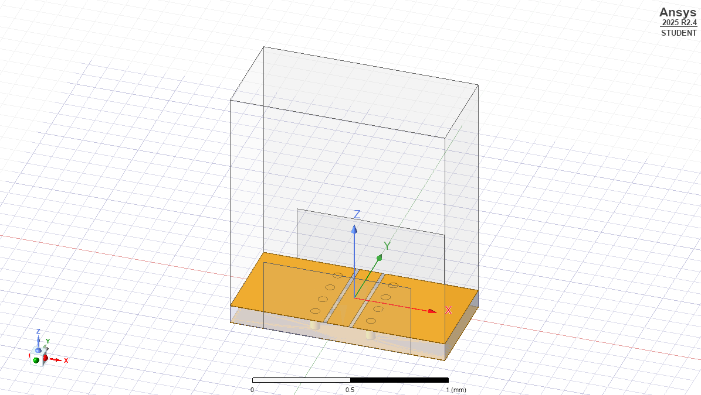
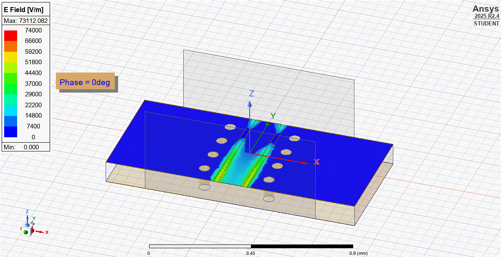
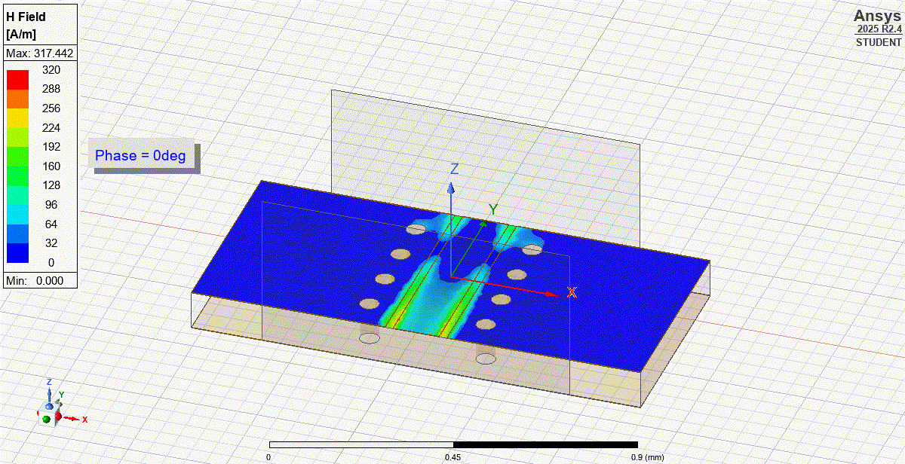

# 3D GCPW Geometry & 90 GHz Field Propagation Animations

3D trimetric view of the Through-Glass-Via (TGV) shielded Grounded Coplanar Waveguide (`W = 119 µm`, `S = 20 µm`, `L = 540.9 µm` on `100 µm` fused silica) alongside phase-swept electric (`|E|`) and magnetic (`|H|`) wave propagation animations at **90 GHz**.

### 3D Trimetric Model View

  

### 90 GHz Wave Propagation (`|E|` vs. `|H|`)

  
  &nbsp;&nbsp;
  

  <em>Left: Electric Field (|E|) confined inside the 20 µm coplanar slots &nbsp;|&nbsp; Right: Magnetic Field (|H|) edge current propagation</em>

