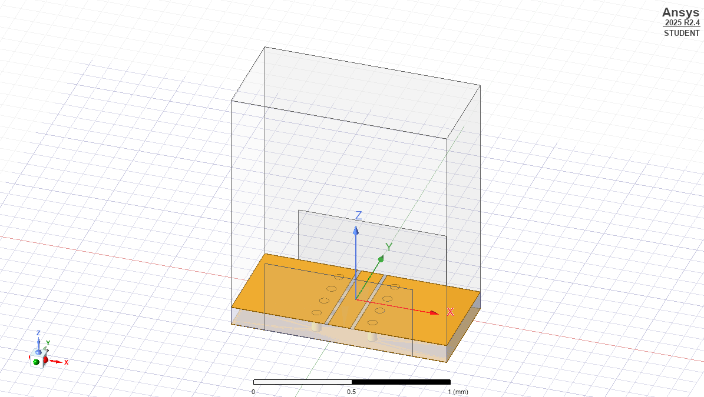
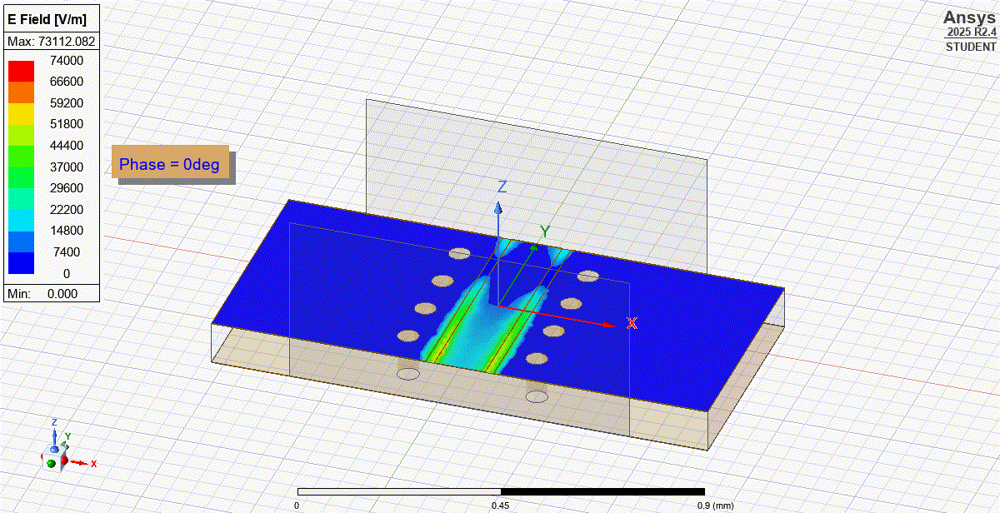
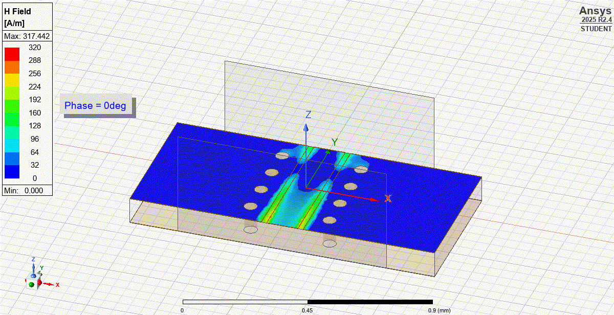

# 60–120 GHz Grounded Coplanar Waveguide (GCPW) Study on Fused Silica

Full-wave 3D electromagnetic simulation study analyzing conductor attenuation and higher-order modal dispersion in a Through-Glass-Via (TGV) shielded Grounded CPW interconnect across **60–120 GHz** using **Ansys HFSS**.

  

  
  &nbsp;&nbsp;
  

  <em>Left: 90 GHz Electric Field (|E|) slot confinement &nbsp;|&nbsp; Right: 90 GHz Magnetic Field (|H|) edge current propagation</em>

---

## 1. What is a Grounded CPW (GCPW)?
A **Grounded Coplanar Waveguide (GCPW)** is a planar millimeter-wave transmission line consisting of a center signal strip separated by two narrow gaps (`S`) from top lateral ground planes, backed by a bottom ground plane beneath the dielectric substrate.

At sub-THz frequencies (`60–120 GHz`), vertical **Through-Glass Vias (TGVs)** stitch the top and bottom grounds together along both sides of the line. This via fence traps the electromagnetic fields tightly around the signal strip, preventing energy from leaking sideways into the substrate as parasitic parallel-plate modes.

---

## 2. Objective & Physical Trade-Off
When sizing `60–120 GHz` interconnects on glass interposers, choosing the center signal trace width (`W`) involves a direct physical trade-off:
* **Too Narrow (`W ≤ 50 µm`):** High-frequency skin effect crowds current into the edges of the strip, raising Ohmic resistance and insertion loss.
* **Too Wide (`W ≥ 400 µm`):** As the trace width approaches half a guided wavelength (`λg / 2`), impedance drops below `50 Ω` and higher-order transverse waveguide modes appear, causing phase distortion, group-delay ripples, and sharp power drops.

**Goal:** Identify the exact geometric sweet spot on a **100 µm fused-silica substrate** that minimizes conductor loss while keeping signal propagation single-mode (Quasi-TEM) and dispersion-free across `60–120 GHz`, establishing verified `50 Ω` feedline bounds for downstream microstrip passive circuits.

---

## 3. Methodology & Stack-Up
1. **Material Stack-Up:** Modeled a `100 µm` fused-silica dielectric (`εr = 3.8`, `tanδ = 0.002`) with `1.5 µm` gold metallization (`5 nm` surface roughness) and `50 µm` diameter gold-filled TGVs spaced at `120 µm` longitudinal pitch (`70 µm` inter-via glass web).
2. **Baseline Synthesis & 3D Tuning:** Synthesized a `50.0 Ω` quarter-wave baseline (`W = 119 µm`, `S = 20 µm`) and tuned the physical length from `528.9 µm` to **`540.9 µm`** in Ansys HFSS (*Driven Terminal* solver) to compensate for TGV inductive phase loading (`−91.42°` at `90 GHz`).
3. **Parametric Width Sweep (`Optimetrics`):** Swept center trace width `W` across 11 values from **`50 µm` to `1100 µm`** across `60–120 GHz` to extract insertion loss (`|S21|`), return loss (`|S11|`), phase linearity, and group delay dispersion.
4. **Full-Wave Modal Verification:** Compared top-down electric (`|E|`) and magnetic (`|H|`) field maps at `W = 119 µm` (`90 GHz`) against `W = 700 µm` (`120 GHz`) to visually verify transverse standing-wave breakdown.

---

## 4. Key Simulation Results
* **50.0 Ω Baseline (`W = 119 µm, S = 20 µm, L = 540.9 µm`):**
  * **Insertion Loss (`|S21|`):** `−0.08 dB` (`60 GHz`), **`−0.10 dB` (`0.185 dB/mm`, 97.7% power transfer at `90 GHz`)**, `−0.13 dB` (`120 GHz`)
  * **Return Loss (`|S11|`):** `−25.74 dB` (`60 GHz`), **`−27.43 dB` (`90 GHz`)**, **`−40.48 dB` (`120 GHz`)**
  * **Port Impedance & Phase:** `50.0 Ω` flat across `60–120 GHz`; `−91.42°` electrical length at `90 GHz` (`2.50 ps` group delay)
* **Verified Operating Window:** Trace widths between **`80 µm` and `235 µm`** achieve minimum attenuation without exciting transverse modes (`95.4 GHz` group-delay resonance observed at `W = 900 µm`).

---

## 5. Repository Structure
* 📄 **[`report/`](report/)** — Complete 6-page technical design note (PDF) with equations, split sweep tables, and `2 × 2` field analysis.
* 🛠️ **[`Model/`](Model/)** — 3D trimetric geometry view and `90 GHz` `|E|` / `|H|` wave propagation animations.
* 📊 **[`plots/`](plots/)** — High-resolution S-parameter, impedance, phase, and group delay sweep plots.
* ⚙️ **[`hfss_model/`](hfss_model/)** — Parameterized Ansys HFSS `.aedt` project file (ready to open and simulate).

